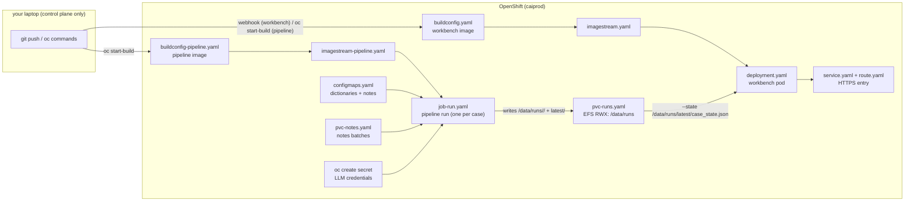

# OpenShift deployment — CIPOC pipeline + workbench

Everything needed to recreate the current state on a fresh cluster. The
manifests in this directory are the whole system; the only objects created
outside of them are secrets and data-bearing ConfigMaps (documented below
as commands, because their contents never belong in git).

## Architecture



| File | Contributes | Notes |
|---|---|---|
| `Dockerfile` (repo root) | Pipeline container image | UBI9, `PYTHONUNBUFFERED=1` for live logs; no ENTRYPOINT, so Job `args` must carry the full command |
| `buildconfig-pipeline.yaml` | Builds pipeline image from repo root on demand | No webhook (1.5 GB image, changes rarely): `oc start-build cipoc-pipeline` |
| `imagestream-pipeline.yaml` | Registry target for pipeline builds | Must exist before builds (builds stall `New (InvalidOutputReference)` without it) |
| `packages/cipoc-workbench/Dockerfile` | Workbench container image | Built by the workbench BuildConfig |
| `buildconfig.yaml` | Workbench image build | Webhook trigger: every push to `dev` rebuilds it |
| `imagestream.yaml` | Registry target for workbench builds | |
| `deployment.yaml` | The workbench pod | Full command in `args` (image has no ENTRYPOINT — `args` alone replaces CMD); `--state` serves `/data/runs/latest/`; mounts EFS runs volume **read-only** |
| `pvc.yaml` | Workbench data (feedback) | gp3, RWO |
| `service.yaml` + `route.yaml` | HTTPS access to the workbench | edge TLS |
| `pvc-runs.yaml` | Shared EFS volume (RWX) | Pipeline writes artifacts + `latest/`; workbench reads. gp3 is RWO and cannot be shared between pods — that's why EFS |
| `pvc-notes.yaml` | Notes batches for real cases | gp3, RWO; populate via uploader Job (see fsGroup lesson below) |
| `configmaps.yaml` | Documents + smoke notes | Synthetic content only — regenerate when SHIRE data arrives, then move documents to a PVC and delete this file |
| `job-run.yaml` | THE launch mechanism | One file = one case run; `sed 's/SMOKE-001/<case>/g' \| oc apply -f -` |

## Fresh-cluster recreation, in order

### 0. Login + project

```bash
oc login https://api.caiprod.rhoai.rh-aiservices-bu.com:6443
oc new-project cipoc-testing    # or: oc project cipoc-testing
```

### 1. Build prerequisites (before any build can run)

```bash
# PAT with repo read access (fine-grained, Contents: read) — feeds BOTH builds
oc create secret generic github-build-secret \
  --type=kubernetes.io/basic-auth \
  --from-literal=username=x-access-token \
  --from-literal=password=<token>

# Workbench webhook: secret first…
oc create secret generic cipoc-workbench-webhook \
  --from-literal=WebHookSecretKey=$(openssl rand -hex 20)
```

Then register the webhook in GitHub (Settings → Webhooks → Add):
payload URL = `https://api.caiprod...:6443/apis/build.openshift.io/v1/namespaces/cipoc-testing/buildconfigs/cipoc-workbench/webhooks/<WebHookSecretKey>/github`,
content type `application/json`, push event. **The API host must be reachable from GitHub's servers** — use the public cluster domain, not an internal address.

### 2. Push manifests, apply storage + config

```bash
git push origin dev        # workbench image builds automatically (webhook)

oc apply -f deploy/openshift/configmaps.yaml
oc apply -f deploy/openshift/pvc-notes.yaml
oc apply -f deploy/openshift/pvc-runs.yaml
```

### 3. Pipeline image (manual — no webhook by design)

```bash
oc start-build cipoc-pipeline
oc wait --for=condition=complete build/cipoc-pipeline-1 --timeout=600s
oc get build cipoc-pipeline-1 -o jsonpath='{.status.output.to.imageDigest}'  # verify
```

### 4. Workbench

```bash
oc apply -f deploy/openshift/imagestream.yaml \
         -f deploy/openshift/deployment.yaml \
         -f deploy/openshift/service.yaml \
         -f deploy/openshift/route.yaml
oc rollout status deploy/cipoc-workbench

# VERIFY: workbench is UP but shows "State: none" until a run exists.
# Do NOT add --state before /data/runs/latest/case_state.json exists —
# the server exits 1 on a missing --state file and crash-loops.
curl -s https://cipoc-workbench-cipoc-testing.apps.caiprod.rhoai.rh-aiservices-bu.com/ -o /dev/null -w '%{http_code}\n'
```

### 5. First pipeline run

The shipped `job-run.yaml` reads its notes from the `cipoc-notes-smoke`
ConfigMap (fixture bundle). The `latest/` directory doesn't exist on a fresh
EFS volume, and the Job's `cp` step creates it (`mkdir -p` lives in the
publisher — see note below). Launch:

```bash
oc apply -f deploy/openshift/job-run.yaml
oc logs -f job/cipoc-run-smoke-001      # live progress; ~4-16 min
oc wait --for=condition=complete job/cipoc-run-smoke-001 --timeout=1200s
```

Verify the run published itself:

```bash
oc run check --rm -i --restart=Never \
  --image=image-registry.openshift-image-registry.svc:5000/cipoc-testing/cipoc-pipeline:latest \
  --overrides='{"spec":{"containers":[{"name":"check","image":"image-registry.openshift-image-registry.svc:5000/cipoc-testing/cipoc-pipeline:latest","command":["sh","-c","ls -la /data/runs/latest/"],"volumeMounts":[{"name":"r","mountPath":"/data/runs"}]}],"volumes":[{"name":"r","persistentVolumeClaim":{"claimName":"cipoc-runs"}}],"restartPolicy":"Never"}}'
```

Then refresh the workbench URL — the run auto-loads (`--state` points at
`/data/runs/latest/case_state.json`, which is re-read from disk on every page
request).

### 6. Subsequent runs

```bash
sed 's/SMOKE-001/<case>/g' deploy/openshift/job-run.yaml | oc apply -f -
oc logs -f job/cipoc-run-<case>
# refresh workbench when the job completes
```

Notes for real batches live on `pvc-notes` (populate via an uploader Job with
`securityContext.fsGroup: 1001500000` — the PVC's group; a random-UID pod
cannot write without it). Swap the Job's `notes` volume from the ConfigMap to
the PVC.

## Hard-won gotchas (each cost a debugging session)

1. **No ENTRYPOINT in either image → `args:` replaces the CMD binary.** The
   workbench CrashLooped with `exec: --: invalid option` when only flag-args
   were supplied. Always include the binary as the first `args` element (or
   use `command:`).
2. **`--state` file must exist at workbench boot.** Server exits 1 on a
   missing file. Seed `/data/runs/latest/` before rolling a workbench that
   uses `--state`.
3. **`contextDir: .` / misplaced `dockerfilePath:` are silently dropped** by
   this cluster's BuildConfig admission. Keep the Dockerfile at the context
   root named `Dockerfile`, use default fields.
4. **An ImageStream referenced by a BuildConfig is NOT auto-created.** Missing
   output target → builds stuck `New (InvalidOutputReference)`. Apply
   `imagestream-pipeline.yaml` before the first build.
5. **`oc create job --from=cronjob/…` cannot take a command override.** The
   per-case CronJob-template design is impossible; per-case Job manifests via
   `sed` is the working pattern (this is why `job-run.yaml` exists).
6. **notes/gp3 PVC group ownership:** first-writer sets group
   `1001500000`; random-UID pods need `securityContext.fsGroup: 1001500000`
   to write. Populate-uploader Jobs must include it.
7. **`oc cp`/`oc exec` refuse Completed pods.** Retrieve artifacts via a
   one-shot reader pod mounting the PVC (pattern in step 5's verify command).
8. **UBI9 ships uid 1001 (`default`)** — never `useradd -u 1001`; reuse the
   built-in user. And `pip install` needs `USER 0` during build.
9. **Managed-cluster API server prunes/denies anonymous endpoints** — the
   API-host webhook 403 was a stale secret key, but plan for RBAC-restricted
   anonymous access on shared clusters.

## Verification (healthy state)

```bash
oc get build cipoc-pipeline-<n> -o jsonpath='{.status.phase}'          # Complete
oc get pods | grep -v build                                            # workbench 1/1
oc logs deploy/cipoc-workbench | head -4                               # State: /data/runs/latest/...
curl -s <workbench-url>/case_state.json | python3 -c "import json,sys; d=json.load(sys.stdin); print(d['run']['status'], d['run']['config_fingerprint']['agent_llm_config']['orchestrator']['model'])"
# expect: completed qwen38-27b-fp8
```

## Data sensitivity

Run artifacts contain full clinical notes (`contains_phi: true` in the schema).
Everything currently in the cluster is **synthetic**. Before real patient data:
PHI approval for the namespace, auth on the route, and the EFS volume's
readability story (anything mounting it reads everything).
